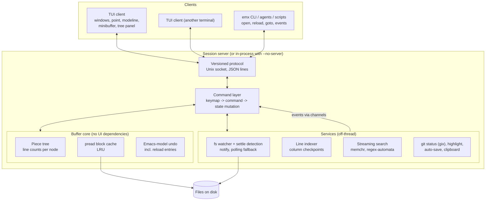

# emx Design

Technical design for `emx`. Product context (problem, users, ranked goals, non-goals, decisions, success criteria) lives in [VISION.md](VISION.md). References to "Goal N" mean the ranked goals there; when goals conflict, the higher-ranked goal wins.

## 1. External Edits and Agent Workflows

The primary use case. Every rule here serves Goal 1 (never lose work).

- **Settle detection, not just debouncing.** Coalesce rapid writes into one reload, and only reload once the file has settled: same size and mtime across two checks a short interval apart. In-place writers are otherwise read half-written. Before a reload replaces a buffer the user has modified, re-check that the file is still settled.
- **Latency trade-off is explicit.** The settle window sets the minimum reload latency. The default is tuned for "updates within a fraction of a second after the last write"; it is configurable.
- **"Changed externally" markers** in the modeline and tree panel for files modified since last viewed.
- **`emx diff-external`** shows a diff between the buffer's previous contents and the new disk contents.
- **Reloads are undoable.** `C-/` restores the pre-reload state.
- **Undoing a reload does not silently clobber the agent.** If the user undoes a reload and then saves, `emx` warns that the save will overwrite newer disk content (the agent's write) and requires confirmation.
- **Follow-edit mode:** optionally jump the viewport to the first changed hunk when a visible file changes on disk.
- **Multi-file operations:** `git checkout`, rebase, stash, and multi-file agent edits reload all affected buffers consistently with a single summary notification.
- **Notifications** are non-modal modeline/echo-area badges for external changes, conflicts, and background task completion, never blocking prompts.

## 2. Session Server and External Control

Client/server is the architecture from milestone 1, inspired by [herdr](https://github.com/herdrdev/herdr)'s server/client design and socket API.

- **Persistent session server.** A daemon owns buffers, undo history, kill ring, and file watchers. The TUI is a thin client attached over a Unix socket. `emx` auto-starts the server if none is running.
- **`--no-server` mode** runs everything in one process. It is first-class: used on constrained boxes, for `sudoedit`, and when the daemon is unwanted. The same core runs in both modes.
- **Survives disconnects.** An SSH drop or terminal close detaches the client; reattaching restores windows, cursor positions, and unsaved edits.
- **Multiple clients.** Several terminals can attach to one session and share buffers. Windows and point are per client; buffers are shared. One watcher per file regardless of client count.
- **Edit journal: a daemon crash loses nothing.** Every edit is appended to a per-buffer journal, with batched fsync (for example, every 200 ms or on idle; the batching also limits SD-card wear). On restart, the server replays the journals and restores every buffer, including unsaved edits. Journals are deleted when a buffer is saved or killed. Emacs-style auto-save files remain as a secondary recovery path.
  - A journal is a sequence of epochs. Each epoch starts with a base: a full snapshot of the buffer when it is at or below `journal_snapshot_max` (default 64 MiB), otherwise the identity (device, inode, size, mtime) of the file the buffer is based on. Edits are byte-offset insert and delete records. A new epoch starts on open, save, reload, and undo of a reload.
  - If an identity-only base no longer matches the file on disk at replay, the buffer cannot be rebuilt exactly. It is restored as a read-only `*recovered: NAME*` buffer listing each journaled edit with its offset and inserted text, so no typed text is lost.
- **`--wait` and `C-x #`.** A client that opened a file with `--wait` is released when the user presses `C-x #` (Emacs's `server-edit`) in that buffer or kills the buffer.
- **Daemon lifetime.** The server exits when the last client detaches and no buffer has unsaved edits, after a short grace period. Unsaved edits keep it running so a reattach recovers them.
- **Privilege isolation.** The socket path is keyed by effective UID, and a client refuses to attach to a server owned by a different UID. `sudo emx /etc/foo` never attaches to the user's daemon and never starts a root daemon whose socket sits in a path the user controls. `$XDG_RUNTIME_DIR` may or may not be preserved under `sudo`, so the lookup does not use it.
  - The socket directory is `/run/user/<euid>/emx` when `/run/user/<euid>` exists, otherwise `/tmp/emx-<euid>`. The directory must be owned by the effective UID with mode `0700`, or `emx` refuses to use it. Both sides check the peer's UID with `SO_PEERCRED` and reject a mismatch.
- **Socket API instead of Lisp.** A small CLI/JSON protocol is the extensibility story:
  - `emx open FILE[:LINE[:COL]]`: open in the running session; usable as `$EDITOR`/`$VISUAL`, with `--wait` for git commit messages.
  - `emx list-buffers`, `emx reload [FILE]`, `emx goto`, `emx save-all`.
  - `emx events`: stream buffer, file, and cursor events as JSON lines.
  - Every message carries a protocol version field from v1 on; scripts will depend on `emx events`, so its shape must be able to evolve.
  - **v1 is disk-only:** the API does not edit buffer contents. Agents write files and `emx` reloads them through the one reload path (sections 1 and 3).
  - **Later: `emx apply-patch FILE < diff`.** Applies a unified diff to the open buffer, on top of any unsaved user edits, as one marked and undoable external change. It fails cleanly (no partial apply) if the hunks don't match, and never saves on the agent's behalf.

## 3. Live Reload from Disk

- Filesystem watching via `notify` (inotify on Linux).
- **Network and FUSE filesystems** (NFS, SMB, sshfs), where inotify misses changes: the filesystem type is detected with `statfs`. On those, only files with open buffers are polled (default every 2 s, configurable), and the tree panel refreshes on focus or on request, never by polling. The modeline shows that the buffer is polled. Settle detection tolerates coarse mtimes there by also comparing size and a tail hash.
- **Unmodified buffer:** reload silently (after settle), preserving cursor position (anchored by line and surrounding context) and scroll.
- **Modified buffer + disk change:** non-destructive conflict handling. Show an indicator in the modeline and offer `diff`, `reload (discard mine)`, or `keep mine`. Three-way merge is out of scope (VISION.md Non-Goals).
- **Append-only growth:** treat a change as an append only when the inode is unchanged, the size grew, and a hash of the last 64 KB before the old end of file is unchanged. Then extend the buffer without re-reading; auto-scroll if the cursor is at the end (follow mode). Anything else is a full reload.
- **Handles** atomic-replace saves (write-temp-and-rename), truncation (including `copytruncate` log rotation), deletion, and rename. A deleted file keeps its buffer and is flagged.
- **Our own saves** are recognized and never trigger a reload loop.
- **Directory panel** also updates live on create, delete, and rename.

## 4. Emacs Keybindings

- **Movement:** `C-f/b/n/p`, `M-f/b`, `C-a/e`, `M-a/e`, `C-v`, `M-v`, `M-<`, `M->`, `M-g g`, `C-l` (recenter cycling).
- **Editing:** `C-d`, `DEL` and `<delete>` (both delete an active region, as `delete-backward-char` and `delete-forward-char` do), `M-d`, `C-k`, `C-w`, `M-w`, `C-y`, `M-y`, `C-/` `C-_` `C-x u` undo, `M-u/l/c`, `C-t`, `M-t`, `C-o`, `C-x C-o`, `M-/` (dabbrev).
- **Mark and region:** `C-SPC`, `C-x C-x`, `C-x h`, mark ring, rectangle commands (`C-x r k/y/t`), registers.
- **Search:** incremental `C-s`/`C-r` with wrap and case smartness; `M-%` query-replace; regexp variants; `occur`. Lazy highlighting of other matches is bounded to the visible region on large files (Goal 2 over Goal 3).
- **Files/buffers/windows:** `C-x C-f`, `C-x C-s`, `C-x C-w`, `C-x b`, `C-x k`, `C-x 2/3/0/1/o`.
- **Minibuffer completion:** vertical incremental completion in the style of `fido-vertical-mode` / vertico. Candidates are listed vertically and narrow as you type; `RET` accepts. Vanilla Emacs completion is not emulated. Used by `C-x C-f`, `C-x b`, and `M-x` (a command palette over the built-in command set). History per prompt.
- **Universal argument** (`C-u`), keyboard macros (`C-x ( ) e`), `C-g` always aborts. `C-z` (`suspend-frame`) stops the terminal client for the shell's `fg`; the server and other clients keep running.
- **Undo follows Emacs's model:** undo is itself undoable, and `C-g` (or any non-undo command) breaks the undo chain. `undo-redo` (Emacs 28) is also provided. Undo history is memory-bounded for huge files.
- **Syntax-aware commands** that Emacs gets from major modes (`TAB` indentation, `M-;` comment) come from built-in per-language rules and tree-sitter, since there is no Lisp. These sit in tier 2 of the command list. Sexp movement (`C-M-f/b`) and filling (`M-q`) are out of scope.
- **Keybindings are data:** a default Emacs keymap, user-overridable via TOML. Defaults avoid stealing Emacs prefixes: the tree panel toggles with `F8` and `M-x toggle-tree`, not `C-x t` (Emacs's tab-bar prefix).

## 5. Large File Support

- **Buffer: a piece tree.** A piece table held in a balanced tree, where each node stores its byte length and line-break count (the design VS Code adopted in 2018 for the same problem). Line lookups are O(log n) and stay correct through edits. Pieces reference either the original file or an append-only edit buffer.
- **Byte-oriented.** The buffer stores bytes, not validated UTF-8. Decoding happens at render time, so invalid UTF-8 in logs and dumps round-trips byte for byte.
- **Original file read via a `pread`-based block cache with LRU eviction, not `mmap`.** Mapping a file that another process truncates or rewrites in place is undefined behavior in Rust (and SIGBUS in practice). With `pread`, truncation is a normal short read that feeds the live-reload logic. This also behaves on NFS.
- **Lazy line indexing:** the line-break counts for the original file are filled in by a background thread. Until a region is indexed, the modeline shows the line number as unknown (`L?`) and navigation uses byte offsets; `M->` jumps to end of file immediately. Going to line N waits only for indexing up to N, with progress shown and `C-g` to cancel. Cold reads from an SD card are bound by device speed (tens of seconds for 2 GB), so this matters on the secondary targets.
- **Long lines** (minified JSON, single-line logs) use soft-wrap windowing plus **column checkpoints**: saved display-width totals at intervals along a line, so placing the cursor at column N does not re-measure every grapheme from the start of the line.
- **Viewport-only rendering and highlighting, with a time budget and hard limits.** Highlighting runs off-thread under a per-frame budget (for example, 4 ms); regions not ready yet paint as plain text and fill in on a later frame. Highlighting is disabled entirely above a file size (default 50 MB) or line length (default 10 KB). All three values are configurable.
- **Small files are read fully into memory.** Files at or below `in_memory_max` (default 16 MiB) are read into memory at open, so the common case never depends on the file staying intact on disk. Larger files use the block cache.
- **Streaming search** over the block cache with `memchr`, `aho-corasick`, and `regex`/`regex-automata`. The `regex` crate does not match across chunk boundaries, so chunks overlap and match length is capped (configurable, default 64 KiB). Search is cancellable with `C-g` and results appear as found.
- **Backward search follows Emacs semantics**: the match found is the one starting closest before point whose anchored forward match ends at or before point (so in `aaa` with point at the end, `aa` is found at position 1, not 0). Plain-string backward search uses `memchr::memmem::FinderRev`. Regexp backward search finds candidate starts by scanning backward for the regex's literal prefixes (extracted with `regex-syntax`) when it has them, and otherwise tries each start position; each candidate is confirmed with an anchored forward match. A reverse DFA is not used, because its leftmost semantics differ from Emacs's.
- **Emacs regexp syntax.** Regexps typed by the user (`C-M-s`, `C-M-%`, `occur`) use Emacs syntax (`\(`, `\|`, `\{`, `` \` ``, `\'`, `\<`, `\>`, `\b`, `\w`, `\W`, `\sw`, `\s-`, `[[:alpha:]]`, literal `(`, `|`, `{`) and are translated to `regex` syntax. Constructs that cannot be translated are rejected with an error naming the construct.
- **Memory** is proportional to edits, viewport, and cache size, not file size.
- **Tail mode:** follow a growing file (`tail -f` semantics), toggled with a command.
- **Large-file save policy.** Default saves are crash-safe (write temp, fsync, rename). Above a size threshold, `emx` warns that this rewrites the whole file and needs free space equal to its size, and offers an in-place write instead (faster, no extra space, not crash-safe). Rename-based saves break hardlinks and may change ownership when the user is not the file's owner; in those cases (and when the directory is not writable) `emx` writes in place, like Emacs's `backup-by-copying`, and preserves permissions, xattrs (including POSIX ACLs), and symlinks (a symlink is resolved and its target is saved).
- **In-place writes move data on disk without extra space.** The buffer's original-file pieces always appear in increasing file order, so an in-place save is a disk `memmove`: pieces that shift left are written first in ascending order, then pieces that shift right in descending order (each copied back to front), then inserted text, then the file is truncated to its new length. Unshifted pieces are not rewritten, so saving a small edit near the end of a huge file is cheap.
- **A buffer is read-only while it is being saved**, because an in-place save rewrites the bytes its pieces refer to. Saves run off the UI thread with progress shown.

## 6. File Viewer Panel

A side-panel file tree drawn in the terminal: a persistent, resizable column on the left of the editor windows, like the project tree in graphical editors, rather than a separate buffer that replaces the file you're editing (as `dired` does).

- Toggled with `F8` or `M-x toggle-tree`; focus switches with `C-x o`. The panel's width is adjustable and remembered per session.
- Lazy-loaded directory listing, respects `.gitignore` (via `ignore`), fast on very large trees.
- Keyboard-driven, following `dired` conventions: `n/p` or `C-n/C-p` to move, `RET`/`TAB` to open/expand, `^` to go up, `d`/`R`/`+` for delete/rename/create with confirmation.
- Git status markers (modified, untracked, ignored) via `gix`, compiled in. No `git` binary is required (Goal 6).
- "Changed externally" markers (section 1) shown alongside git status.
- Opens files into the active window; preview-on-select optional.
- Fuzzy file finder (`C-x C-f` completion and a project-wide quick-open) shares the same index.
- Clicking a file opens it; clicking a directory expands or collapses it; dragging the panel's edge resizes it (section 7, Mouse).

## 7. Editing Fundamentals

- Full UTF-8 and grapheme-cluster-aware cursor movement; wide-character and combining-mark correct rendering.
- **Other encodings:** invalid UTF-8 bytes are shown as escapes and preserved on save. Binary files open in a read-only hex-escaped view. Latin-1 and UTF-16 are detected (BOM, heuristics) and round-tripped. Bidirectional text is shown in logical order (see VISION.md Non-Goals).
- **Terminal safety:** control characters and escape sequences in file content are always rendered escaped, never passed to the terminal. An optional "interpret ANSI colors" view for logs renders SGR color codes only.
- Multiple buffers, split windows (horizontal/vertical), and a buffer list.
- Auto-save and recovery files.
- **Clipboard via OSC 52, kill ring to system clipboard only.** Most terminals block or don't support reading the clipboard through OSC 52, so syncing from the system clipboard into the kill ring is not promised. Inside tmux, the default `set-clipboard external` ignores OSC 52 from programs, so users need `set -g set-clipboard on`; this is documented.
- Line endings, tabs/spaces, trailing whitespace, and final-newline handling configurable per file type.
- Tree-sitter syntax highlighting, auto-indent, and bracket matching (bundled grammars for a defined language set), within the highlighting budget and limits of section 5. No LSP client (VISION.md Non-Goals). The highlighter re-parses a buffer whole rather than incrementally; jobs for older text are coalesced away, and faces move with edits until a new answer arrives.
- **Mouse:** click to place point and select a window, drag to set the region, double- and triple-click to select a word or line, wheel scrolling, clicking the modeline to select a window, dragging window dividers and the panel edge to resize, and clicks in the file panel. Decoded as SGR mouse reports (mode 1006) through the same pluggable input interface as keys, so it works in every supported terminal, including tmux and screen with their mouse options on. Mouse reporting is opt-in (`mouse = true`, or `M-x xterm-mouse-mode` for the session), because it takes over the terminal's native drag-to-select, which users rely on over SSH; Emacs `-nw` leaves `xterm-mouse-mode` off for the same reason. When enabled, the Shift-drag bypass is documented.

## 8. Performance Principles

- **Never block the UI thread.** I/O, indexing, searching, highlighting, git status, and file watching run off-thread and communicate by message passing.
- **Render on demand.** Dirty-region diffing and one write per frame; no full-screen redraws; low idle CPU (event-driven, no wakeups when idle except configured polling fallbacks and tail mode).
- **Budgeted work.** Anything O(file size) is incremental, cancellable, and has a visible progress indicator.
- **Measure where it matters.** Benchmarks in CI for startup time, open time, scroll latency, search throughput, reload latency, and memory against defined file corpora (10 MB, 1 GB, 10 GB, long-line files). Runs include **cold-cache** passes (page cache dropped between runs) and **aarch64** runs on real hardware or a self-hosted runner, not only warm-cache x86.
- **Targets** (to be validated, not promises):
  - Keypress-to-paint under 16 ms at all file sizes, measured locally at the PTY (not over SSH).
  - First paint under 50 ms on a Raspberry Pi 4 with a warm cache, for any file size.
  - Memory overhead for an unedited multi-GB file in single-digit MB, plus the block cache budget.
  - External write to updated buffer: within the settle window plus 100 ms.
  - Binary size: budget to be set before M2, with the bundled grammar set counted against it.
- **Allocator:** static musl builds use `mimalloc` (or `jemalloc`); musl's default allocator is too slow for this workload.

## 9. Architecture

- Client/server from milestone 1. Buffers, undo, kill ring, and watchers live in the server; windows and point are per client. `--no-server` runs the same core in one process.
- Event loop with worker threads (or a small async runtime) communicating via channels.
- Buffer core has no UI dependencies and is independently testable and benchmarkable.
- Keymaps and commands are plain Rust enums/tables loaded from defaults plus TOML overrides.
- Candidate crates: `crossterm`, `ratatui` (or a custom diff renderer), `notify`, `regex`, `regex-automata`, `memchr`, `aho-corasick`, `unicode-segmentation`, `unicode-width`, `ignore`, `gix`, `tree-sitter`, `serde`/`toml`, `mimalloc`.

### Why Rust

The author's usual stack is Go. Rust is chosen here for `regex-automata` (reverse DFA, streaming control), first-class tree-sitter bindings, the `crossterm`/`ratatui` terminal ecosystem, and no GC pauses during scrolling and rendering of very large buffers.

## 10. Testing

- **Tiered command list.** Tier 1: the everyday commands in section 4, which must match Emacs exactly. Tier 2: syntax-aware commands (indentation, comments), which must match closely for supported languages. Tier 3: any other Emacs command `emx` implements, best effort. Commands listed as out of scope in VISION.md are not implemented at any tier.
- **Differential testing against real Emacs.** For each command test, run the same keystroke sequence through `emacs --batch -Q` with `execute-kbd-macro` and through `emx`, then compare buffer contents, point, mark, and kill ring. The tier-1 pass rate is a CI-enforced number; this turns "Emacs-native feel" into a measurement.
- **Property tests and fuzzing** of the piece tree (random edit sequences against a naive reference), the line indexer, and the reload/conflict logic (random interleavings of user edits and external writes, asserting Goal 1: no content lost).
- **Terminal matrix, phased.** Keyboard input decoding sits behind a configurable interface so new encodings can be added without touching the command layer.
  - **First release (M1-M4):** terminals that speak the Kitty keyboard protocol (Kitty, WezTerm, Ghostty, foot), tested in CI. Other terminals are unsupported in this release: at startup `emx` queries for the protocol and, if the terminal does not answer, exits with an error naming the supported terminals.
  - **Next release (M5):** legacy Linux terminals (GNOME Terminal, Alacritty, xterm, Linux console) and tmux and screen (where the Kitty protocol often does not pass through, so legacy decoding applies even inside a Kitty terminal). The startup check stops being fatal: a terminal that does not answer the Kitty query falls back to legacy decoding. Each terminal joins the CI matrix when it lands.
  - **Later (M8):** macOS Terminal.app and iTerm2.
  - **Not supported:** Konsole. It is not in the CI matrix and its quirks are not worked around.

## 11. Configuration

- Single optional file at `~/.config/emx/config.toml`.
- Scope: keybinding overrides, keyboard input encoding, theme/colors, tab width and indent rules per filetype, panel defaults, mouse on/off, large-file thresholds, highlighting budget and limits, save policy, settle window, watcher mode and polling interval, journal fsync interval, search match-length cap.
- No scripting. Anything requiring logic is a built-in feature, done through the socket API, or out of scope.
- macOS: documents setting Option as Meta in Terminal.app and iTerm2; without it, `M-` keys fail silently.

## 12. Milestones

The **first release** is M1 through M4: the first build others are asked to use daily. It supports Kitty-protocol terminals only. The **next release** is M5 through M7: Linux terminal coverage, the file panel with mouse support, and syntax highlighting. M8 onward ship after that. Dogfooding starts after M2.

Status (2026-11-15): M1 through M10 are done; M5-M7 follow `docs/superpowers/plans/2026-11-15-emx-next-release.md`. The static x86_64 binary is 13 MB with the bundled grammars and `gix` (5 MB before them). Two parts of M8 are partial: Latin-1 and UTF-16 files are kept byte for byte (shown with escapes) rather than detected and converted, because a converted buffer's coding would also have to survive the edit journal's crash recovery; and macOS builds but is not tested at run time.

Revised 2026-11-15: terminal coverage moved ahead of the file panel; mouse support widened from the panel to the whole editor; sexp movement, fill, the help system, version control, running programs, LSP, three-way merge, and remote file support moved out of scope (VISION.md Non-Goals).

1. **Core and server.** Piece tree over the `pread` block cache, byte-oriented storage, client/server split with per-client windows and point, `--no-server` mode, daemon lifetime rules, edit journal with crash replay, terminal renderer with control-character escaping, Kitty keyboard protocol decoding behind a pluggable input interface, basic movement and editing, open/save with the save policy, kill ring, Emacs-model undo, protocol v1 (`open`, `--wait`, `events`), UID-keyed sockets, auto-save, and the differential-testing harness.
2. **External edits and live reload.** Watcher with settle detection, append detection, conflict UX (diff / reload / keep mine), atomic-save and truncation handling, network-filesystem detection and polling of open buffers, undoable reloads with the save-after-undo warning, change markers, `diff-external`, multi-file summary notifications, follow-edit mode.
3. **Emacs tier-1 parity.** Full tier-1 keymap, vertical minibuffer completion, incremental search, query-replace, marks, regions, registers, windows, macros, universal argument.
4. **Large files.** Background line indexer, column checkpoints, streaming search with reverse DFA, long-line handling, tail/follow mode, benchmark suite with cold-cache and aarch64 runs.
5. **Linux terminal coverage.** Legacy key decoding with non-fatal fallback from the Kitty protocol; GNOME Terminal, Alacritty, xterm, the Linux console, tmux, and screen added to the CI matrix.
6. **File panel and mouse.** Lazy tree, gitignore, `gix` git status markers, change markers, file operations, quick-open; opt-in mouse support across windows, the minibuffer, and the panel (section 7).
7. **Syntax highlighting.** Tree-sitter highlighting, bracket matching, and the tier-2 commands (`TAB` indentation, `M-;` comments) for the bundled language set.
8. **Polish.** macOS Terminal.app and iTerm2, OSC 52 clipboard, themes, ANSI-color log view, encoding detection, binary-file view, per-filetype line-ending/tab/whitespace handling. (Packaging, static musl builds with `mimalloc` and `.deb`, shipped early with the first release.)
9. **Agent patch API.** `emx apply-patch` with clean failure on mismatched hunks.
10. **Later / optional.** Rectangle editing enhancements.

TOML config is not a polish item: it lands incrementally from M1 as each configurable value appears.

## 13. Technical Risks

- **Server complexity.** Protocol versioning, stale-socket cleanup, UID checks, journal replay correctness. `--no-server` must stay first-class and exercised in CI.
- **Journal cost on flash storage.** Batched fsync limits SD-card wear, but the interval must be validated on real Pi hardware.
- **Provisional numbers.** These are starting values to validate, not measured facts: the 64 KB tail hash for append detection, 50 ms first paint on a Pi 4, settle window + 100 ms reload latency, 2 s polling, 4 ms highlight budget, 50 MB / 10 KB highlight cutoffs, 200 ms journal fsync batching.
