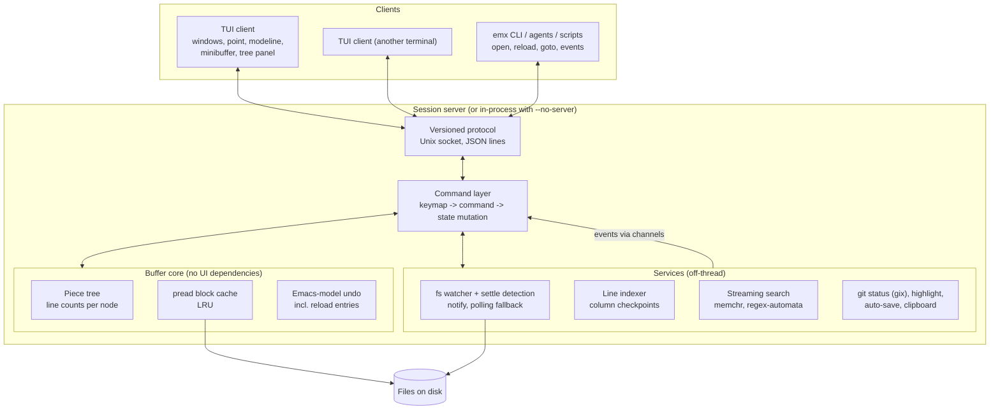

# Vision: An Emacs-Keybinding Terminal Editor for Working Alongside Coding Agents

Name: **`emx`**. License: dual MIT/Apache-2.0. Personal open-source project.

## One-liner

A fast terminal editor with Emacs keybindings, built for humans working alongside coding agents: it watches files that agents, build tools, and `git` rewrite, shows what changed, never loses either side's work, and can itself be driven over a socket. It also handles multi-GB files and ships as one static binary, so it is a practical `emacs-nox` replacement on remote and constrained boxes.

## Problem

### Editing next to agents

Coding agents and build tools rewrite files in bursts, often several files at once, while a human has the same files open. Today's editors treat that as an edge case:

- Changes land silently or behind a blocking "file changed on disk" prompt. There is no quick way to see *what* the agent changed, accept it, or roll it back.
- A buffer the human has modified and a file the agent has rewritten collide. The usual outcome is that one side's work is lost.
- Writers that rewrite a file in place (no temp-file-plus-rename) are seen half-written, and the editor reloads garbage.
- Agents and scripts have no simple, stable way to tell the editor "open this at line N", "reload these", or "tell me what the user is looking at".

### Emacs in the terminal

`emacs-nox` is the default terminal editor for many Emacs users, but:

- Startup with a real config is slow relative to `vi`/`nano`. `emacs -Q` starts quickly but gives up the config; `emacs --daemon` plus `emacsclient -t` starts instantly but keeps a full Emacs resident, which is heavy on small boxes.
- Large files (logs, dumps, minified JSON) bog it down. The `vlf` package exists but is chunked and awkward to use.
- `auto-revert-mode` is opt-in. It uses inotify where available (`auto-revert-use-notify`, Emacs 24.4+), but falls back to polling on network filesystems, and conflict handling for a modified buffer is a blocking prompt.
- No built-in project/file tree without extra packages and configuration.
- Its power comes from Elisp, which most of these use cases don't need but pay for in startup time and memory.

### Prior art

- **Modal editors** (Helix, Neovim, Kakoune) are fast but force a different muscle memory.
- **Small Emacs-style editors** (mg, zile, jed) are fast but lack large-file handling, a file tree, live reload, and modern conveniences.
- **`micro`** is the main fast, non-modal modern TUI editor, but does not use Emacs keybindings.
- **Rust Emacs-alikes** (`zee`, `remacs`, `emacs-ng`) and **`lem`** (Common Lisp): `zee` is the closest in spirit and was abandoned; `remacs` and `emacs-ng` aimed to port Emacs itself. Their histories are a warning about scope (see Risks).

## Vision

An agent rewrites six files while you have three of them open. Each buffer updates within a moment of the writes settling, the modeline and tree panel mark what changed, `emx diff-external` shows the hunks, and `C-/` takes any of it back. Nothing you had typed is lost. The agent itself can call `emx open src/main.rs:42` to show you where it is working.

The same binary, copied to a server or SBC, opens a 2 GB log over SSH instantly, navigates with `C-s`, `C-v`, `M-<`, `C-x C-f`, and follows the log as it grows. No config required, no scripting language, one static binary.

## Target Users

1. **Primary: developers working alongside coding agents.** On a workstation, with agents, build tools, and `git` rewriting files underneath them. They need to see, review, accept, and undo external changes without losing their own edits, and want the editor scriptable from the agent side.
2. **Secondary: Emacs users on remote and constrained boxes.** Servers, containers, Raspberry Pi / Orange Pi, and embedded Linux, where `emacs-nox` is too heavy or unavailable. They edit logs, configs, YAML/JSON, and source over SSH.

Platform: Linux-first (Ubuntu/Debian), macOS secondary. Windows is out of scope.

## Goals

Goals are ranked. When two conflict, the higher one wins.

1. **Never lose work.** Neither the user's edits nor an agent's writes are ever silently discarded. Every reload is undoable; every overwrite of newer disk content is a deliberate, warned action.
2. **Always responsive.** The UI thread never blocks: no input lag at any file size, rendering never waits on I/O, multi-GB files open instantly and scroll smoothly. Where exact Emacs behavior would block (for example, highlighting every match in a 2 GB file on each keystroke), `emx` deviates from Emacs.
3. **Emacs-native feel.** Keybindings, kill ring, mark ring, minibuffer, incremental search, universal argument, and undo behave as Emacs users expect, for the commands in the tier-1 list (see Testing).
4. **Live disk sync.** Buffers reflect external changes automatically, including bursts of agent writes and logs that are appended to.
5. **Drivable from outside.** A stable, versioned socket API lets agents, scripts, and other TUIs open files, trigger reloads, and subscribe to events.
6. **File panel, zero-config, single static binary.** A toggleable tree panel with git status; sensible defaults with optional TOML config; no runtime dependencies, easy to `scp` anywhere.

## Non-Goals

- No Lisp, no embedded scripting language, no package ecosystem. Extensibility is TOML config plus the socket API.
- No Org-mode, Magit, Gnus, or other Emacs applications.
- Not a GUI editor and not a full IDE. Tree-sitter is used for syntax-aware editing; LSP is a later, optional layer.
- No Vi/modal mode (may be revisited, but not a goal).
- No full Emacs-compatibility guarantee. Compatibility is defined by a tiered command list and measured against real Emacs (see Testing).
- No buffer editing over the socket in v1. Agents change files on disk; a patch API comes later (Feature 2). A general edit API (ranges, cursor control, transactions) is not planned.
- No bidirectional text layout. RTL text is stored, displayed in logical order, and round-tripped correctly, but not visually reordered. Terminals handle bidi inconsistently, and editor-side reordering can double-apply.
- Windows support.

## Core Features

### 1. External Edits and Agent Workflows

The primary use case. Every rule here serves Goal 1 (never lose work).

- **Settle detection, not just debouncing.** Coalesce rapid writes into one reload, and only reload once the file has settled: same size and mtime across two checks a short interval apart. In-place writers are otherwise read half-written. Before a reload replaces a buffer the user has modified, re-check that the file is still settled.
- **Latency trade-off is explicit.** The settle window sets the minimum reload latency. The default is tuned for "updates within a fraction of a second after the last write"; it is configurable.
- **"Changed externally" markers** in the modeline and tree panel for files modified since last viewed.
- **`emx diff-external`** shows a diff between the buffer's previous contents and the new disk contents.
- **Reloads are undoable.** `C-/` restores the pre-reload state.
- **Undoing a reload does not silently clobber the agent.** If the user undoes a reload and then saves, `emx` warns that the save will overwrite newer disk content (the agent's write) and requires confirmation.
- **Follow-edit mode:** optionally jump the viewport to the first changed hunk when a visible file changes on disk.
- **Multi-file operations:** `git checkout`, rebase, stash, and multi-file agent edits reload all affected buffers consistently with a single summary notification.
- **Notifications** are non-modal modeline/echo-area badges for external changes, conflicts, and background task completion, never blocking prompts.

### 2. Session Server and External Control

Client/server is the architecture from milestone 1, inspired by [herdr](https://github.com/herdrdev/herdr)'s server/client design and socket API.

- **Persistent session server.** A daemon owns buffers, undo history, kill ring, and file watchers. The TUI is a thin client attached over a Unix socket. `emx` auto-starts the server if none is running.
- **`--no-server` mode** runs everything in one process. It is first-class: used on constrained boxes, for `sudoedit`, and when the daemon is unwanted. The same core runs in both modes.
- **Survives disconnects.** An SSH drop or terminal close detaches the client; reattaching restores windows, cursor positions, and unsaved edits.
- **Multiple clients.** Several terminals can attach to one session and share buffers. Windows and point are per client; buffers are shared. One watcher per file regardless of client count.
- **Edit journal: a daemon crash loses nothing.** Every edit is appended to a per-buffer journal, with batched fsync (for example, every 200 ms or on idle; the batching also limits SD-card wear). On restart, the server replays the journals and restores every buffer, including unsaved edits. Journals are deleted when a buffer is saved or killed. Emacs-style auto-save files remain as a secondary recovery path.
- **Daemon lifetime.** The server exits when the last client detaches and no buffer has unsaved edits, after a short grace period. Unsaved edits keep it running so a reattach recovers them.
- **Privilege isolation.** The socket path is keyed by effective UID, and a client refuses to attach to a server owned by a different UID. `sudo emx /etc/foo` never attaches to the user's daemon and never starts a root daemon whose socket sits in a path the user controls. `$XDG_RUNTIME_DIR` may or may not be preserved under `sudo`, so the lookup does not trust it alone.
- **Socket API instead of Lisp.** A small CLI/JSON protocol is the extensibility story:
  - `emx open FILE[:LINE[:COL]]`: open in the running session; usable as `$EDITOR`/`$VISUAL`, with `--wait` for git commit messages.
  - `emx list-buffers`, `emx reload [FILE]`, `emx goto`, `emx save-all`.
  - `emx events`: stream buffer, file, and cursor events as JSON lines.
  - Every message carries a protocol version field from v1 on; scripts will depend on `emx events`, so its shape must be able to evolve.
  - **v1 is disk-only:** the API does not edit buffer contents. Agents write files and `emx` reloads them through the one reload path (Feature 1 and 3).
  - **Later: `emx apply-patch FILE < diff`.** Applies a unified diff to the open buffer, on top of any unsaved user edits, as one marked and undoable external change. It fails cleanly (no partial apply) if the hunks don't match, and never saves on the agent's behalf.

### 3. Live Reload from Disk

- Filesystem watching via `notify` (inotify on Linux).
- **Network and FUSE filesystems** (NFS, SMB, sshfs), where inotify misses changes: the filesystem type is detected with `statfs`. On those, only files with open buffers are polled (default every 2 s, configurable), and the tree panel refreshes on focus or on request, never by polling. The modeline shows that the buffer is polled. Settle detection tolerates coarse mtimes there by also comparing size and a tail hash.
- **Unmodified buffer:** reload silently (after settle), preserving cursor position (anchored by line and surrounding context) and scroll.
- **Modified buffer + disk change:** non-destructive conflict handling. Show an indicator in the modeline and offer `diff`, `reload (discard mine)`, or `keep mine`. Three-way merge against the last-saved base is deferred to a later milestone.
- **Append-only growth:** treat a change as an append only when the inode is unchanged, the size grew, and a hash of the last 64 KB before the old end of file is unchanged. Then extend the buffer without re-reading; auto-scroll if the cursor is at the end (follow mode). Anything else is a full reload.
- **Handles** atomic-replace saves (write-temp-and-rename), truncation (including `copytruncate` log rotation), deletion, and rename. A deleted file keeps its buffer and is flagged.
- **Our own saves** are recognized and never trigger a reload loop.
- **Directory panel** also updates live on create, delete, and rename.

### 4. Emacs Keybindings

- **Movement:** `C-f/b/n/p`, `M-f/b`, `C-a/e`, `M-a/e`, `C-v`, `M-v`, `M-<`, `M->`, `M-g g`, `C-l` (recenter cycling).
- **Editing:** `C-d`, `M-d`, `C-k`, `C-w`, `M-w`, `C-y`, `M-y`, `C-/` `C-_` `C-x u` undo, `M-u/l/c`, `C-t`, `M-t`, `C-o`, `C-x C-o`, `M-/` (dabbrev).
- **Mark and region:** `C-SPC`, `C-x C-x`, `C-x h`, mark ring, rectangle commands (`C-x r k/y/t`), registers.
- **Search:** incremental `C-s`/`C-r` with wrap and case smartness; `M-%` query-replace; regexp variants; `occur`. Lazy highlighting of other matches is bounded to the visible region on large files (Goal 2 over Goal 3).
- **Files/buffers/windows:** `C-x C-f`, `C-x C-s`, `C-x C-w`, `C-x b`, `C-x k`, `C-x 2/3/0/1/o`.
- **Minibuffer completion:** vertical incremental completion in the style of `fido-vertical-mode` / vertico. Candidates are listed vertically and narrow as you type; `RET` accepts. Vanilla Emacs completion is not emulated. Used by `C-x C-f`, `C-x b`, and `M-x` (a command palette over the built-in command set). History per prompt.
- **Universal argument** (`C-u`), keyboard macros (`C-x ( ) e`), `C-g` always aborts.
- **Undo follows Emacs's model:** undo is itself undoable, and `C-g` (or any non-undo command) breaks the undo chain. `undo-redo` (Emacs 28) is also provided. Undo history is memory-bounded for huge files.
- **Syntax-aware commands** that Emacs gets from major modes (`TAB` indentation, `M-;` comment, `C-M-f/b` sexp movement, `M-q` fill) come from built-in per-language rules and tree-sitter, since there is no Lisp. These sit in tier 2 of the command list.
- **Keybindings are data:** a default Emacs keymap, user-overridable via TOML. Defaults avoid stealing Emacs prefixes: the tree panel toggles with `F8` and `M-x toggle-tree`, not `C-x t` (Emacs's tab-bar prefix).

### 5. Large File Support

- **Buffer: a piece tree.** A piece table held in a balanced tree, where each node stores its byte length and line-break count (the design VS Code adopted in 2018 for the same problem). Line lookups are O(log n) and stay correct through edits. Pieces reference either the original file or an append-only edit buffer.
- **Byte-oriented.** The buffer stores bytes, not validated UTF-8. Decoding happens at render time, so invalid UTF-8 in logs and dumps round-trips byte for byte.
- **Original file read via a `pread`-based block cache with LRU eviction, not `mmap`.** Mapping a file that another process truncates or rewrites in place is undefined behavior in Rust (and SIGBUS in practice). With `pread`, truncation is a normal short read that feeds the live-reload logic. This also behaves on NFS.
- **Lazy line indexing:** the line-break counts for the original file are filled in by a background thread. Until a region is indexed, the modeline shows the line number as unknown (`L?`) and navigation uses byte offsets; `M->` jumps to end of file immediately. Going to line N waits only for indexing up to N, with progress shown and `C-g` to cancel. Cold reads from an SD card are bound by device speed (tens of seconds for 2 GB), so this matters on the secondary targets.
- **Long lines** (minified JSON, single-line logs) use soft-wrap windowing plus **column checkpoints**: saved display-width totals at intervals along a line, so placing the cursor at column N does not re-measure every grapheme from the start of the line.
- **Viewport-only rendering and highlighting, with a time budget and hard limits.** Highlighting runs off-thread under a per-frame budget (for example, 4 ms); regions not ready yet paint as plain text and fill in on a later frame. Highlighting is disabled entirely above a file size (default 50 MB) or line length (default 10 KB). All three values are configurable.
- **Streaming search** over the block cache with `memchr`, `aho-corasick`, and `regex`/`regex-automata`. The `regex` crate does not match across chunk boundaries, so chunks overlap and match length is capped (configurable). Reverse search (`C-r`) uses `regex-automata`'s reverse DFA. Search is cancellable with `C-g` and results appear as found.
- **Memory** is proportional to edits, viewport, and cache size, not file size.
- **Tail mode:** follow a growing file (`tail -f` semantics), toggled with a command.
- **Large-file save policy.** Default saves are crash-safe (write temp, fsync, rename). Above a size threshold, `emx` warns that this rewrites the whole file and needs free space equal to its size, and offers an in-place write instead (faster, no extra space, not crash-safe). Rename-based saves break hardlinks and may change ownership when the user is not the file's owner; in those cases `emx` writes in place by copying, like Emacs's `backup-by-copying`, and preserves permissions, xattrs, and symlinks.

### 6. File Viewer Panel

A side-panel file tree drawn in the terminal: a persistent, resizable column on the left of the editor windows, like the project tree in graphical editors, rather than a separate buffer that replaces the file you're editing (as `dired` does).

- Toggled with `F8` or `M-x toggle-tree`; focus switches with `C-x o`. The panel's width is adjustable and remembered per session.
- Lazy-loaded directory listing, respects `.gitignore` (via `ignore`), fast on very large trees.
- Keyboard-driven, following `dired` conventions: `n/p` or `C-n/C-p` to move, `RET`/`TAB` to open/expand, `^` to go up, `d`/`R`/`+` for delete/rename/create with confirmation.
- Git status markers (modified, untracked, ignored) via `gix`, compiled in. No `git` binary is required (Goal 6).
- "Changed externally" markers (Feature 1) shown alongside git status.
- Opens files into the active window; preview-on-select optional.
- Fuzzy file finder (`C-x C-f` completion and a project-wide quick-open) shares the same index.
- **Mouse support is opt-in** (click, scroll, resize). Enabling mouse reporting takes over the terminal's native drag-to-select, which users rely on over SSH; Emacs `-nw` leaves `xterm-mouse-mode` off for the same reason. When enabled, Shift-drag bypass is documented.

### 7. Editing Fundamentals

- Full UTF-8 and grapheme-cluster-aware cursor movement; wide-character and combining-mark correct rendering.
- **Other encodings:** invalid UTF-8 bytes are shown as escapes and preserved on save. Binary files open in a read-only hex-escaped view. Latin-1 and UTF-16 are detected (BOM, heuristics) and round-tripped. Bidirectional text is shown in logical order (see Non-Goals).
- **Terminal safety:** control characters and escape sequences in file content are always rendered escaped, never passed to the terminal. An optional "interpret ANSI colors" view for logs renders SGR color codes only.
- Multiple buffers, split windows (horizontal/vertical), and a buffer list.
- Auto-save and recovery files.
- **Clipboard via OSC 52, kill ring to system clipboard only.** Most terminals block or don't support reading the clipboard through OSC 52, so syncing from the system clipboard into the kill ring is not promised. Inside tmux, the default `set-clipboard external` ignores OSC 52 from programs, so users need `set -g set-clipboard on`; this is documented.
- Line endings, tabs/spaces, trailing whitespace, and final-newline handling configurable per file type.
- Tree-sitter syntax highlighting, auto-indent, and bracket matching (bundled grammars for a defined language set). LSP client (diagnostics, go-to-definition) as a later, optional layer.

## Performance Principles

- **Never block the UI thread.** I/O, indexing, searching, highlighting, git status, and file watching run off-thread and communicate by message passing.
- **Render on demand.** Dirty-region diffing and one write per frame; no full-screen redraws; low idle CPU (event-driven, no wakeups when idle except configured polling fallbacks and tail mode).
- **Budgeted work.** Anything O(file size) is incremental, cancellable, and has a visible progress indicator.
- **Measure where it matters.** Benchmarks in CI for startup time, open time, scroll latency, search throughput, reload latency, and memory against defined file corpora (10 MB, 1 GB, 10 GB, long-line files). Runs include **cold-cache** passes (page cache dropped between runs) and **aarch64** runs on real hardware or a self-hosted runner, not only warm-cache x86.
- **Targets** (to be validated, not promises):
  - Keypress-to-paint under 16 ms at all file sizes, measured locally at the PTY (not over SSH).
  - First paint under 50 ms on a Raspberry Pi 4 with a warm cache, for any file size.
  - Memory overhead for an unedited multi-GB file in single-digit MB, plus the block cache budget.
  - External write to updated buffer: within the settle window plus 100 ms.
  - Binary size: budget to be set before M2, with the bundled grammar set counted against it.
- **Allocator:** static musl builds use `mimalloc` (or `jemalloc`); musl's default allocator is too slow for this workload.

## Architecture Sketch

- Client/server from milestone 1. Buffers, undo, kill ring, and watchers live in the server; windows and point are per client. `--no-server` runs the same core in one process.
- Event loop with worker threads (or a small async runtime) communicating via channels.
- Buffer core has no UI dependencies and is independently testable and benchmarkable.
- Keymaps and commands are plain Rust enums/tables loaded from defaults plus TOML overrides.
- Candidate crates: `crossterm`, `ratatui` (or a custom diff renderer), `notify`, `regex`, `regex-automata`, `memchr`, `aho-corasick`, `unicode-segmentation`, `unicode-width`, `ignore`, `gix`, `tree-sitter`, `serde`/`toml`, `mimalloc`.

### Why Rust

The author's usual stack is Go. Rust is chosen here for `regex-automata` (reverse DFA, streaming control), first-class tree-sitter bindings, the `crossterm`/`ratatui` terminal ecosystem, and no GC pauses during scrolling and rendering of very large buffers.

## Testing

- **Tiered command list.** Tier 1: the everyday commands in Feature 4, which must match Emacs exactly. Tier 2: syntax-aware commands (indentation, comments, sexp movement, fill), which must match closely for supported languages. Tier 3: everything else, best effort.
- **Differential testing against real Emacs.** For each command test, run the same keystroke sequence through `emacs --batch -Q` with `execute-kbd-macro` and through `emx`, then compare buffer contents, point, mark, and kill ring. The tier-1 pass rate is a CI-enforced number; this turns "Emacs-native feel" into a measurement.
- **Property tests and fuzzing** of the piece tree (random edit sequences against a naive reference), the line indexer, and the reload/conflict logic (random interleavings of user edits and external writes, asserting Goal 1: no content lost).
- **Terminal matrix, phased.** Keyboard input decoding sits behind a configurable interface so new encodings can be added without touching the command layer.
  - **First release (M1-M4):** terminals that speak the Kitty keyboard protocol (Kitty, WezTerm, Ghostty, foot), tested in CI. Other terminals are unsupported in this release.
  - **Later releases:** legacy Linux terminals (GNOME Terminal, Konsole, Alacritty, xterm, Linux console), tmux and screen (where the Kitty protocol often does not pass through, so legacy decoding applies even inside a Kitty terminal), and macOS Terminal.app and iTerm2. Each joins the CI matrix when it lands.

## Configuration

- Single optional file at `~/.config/emx/config.toml`.
- Scope: keybinding overrides, keyboard input encoding, theme/colors, tab width and indent rules per filetype, panel defaults, mouse on/off, large-file thresholds, highlighting budget and limits, save policy, settle window, watcher mode and polling interval, journal fsync interval, search match-length cap.
- No scripting. Anything requiring logic is a built-in feature, done through the socket API, or out of scope.
- macOS: documents setting Option as Meta in Terminal.app and iTerm2; without it, `M-` keys fail silently.

## Success Criteria

- A developer can keep files open while an agent rewrites them, see every change, and undo any reload, with zero lost edits in the fuzzing suite and in daily use.
- Agents and scripts can open files, trigger reloads, and follow events through the socket API without knowing editor internals.
- An Emacs user can switch from `emacs-nox` and stay productive on the tier-1 command list without relearning, with the differential test pass rate as the measure.
- Opening and navigating a multi-GB log meets the first-paint and keypress-to-paint targets, including cold-cache runs on aarch64.
- Runs well on a Raspberry Pi or Orange Pi over a slow SSH link, from a supported terminal (Kitty-protocol terminals in the first release; tmux and screen in a later one).
- A daemon crash, killed mid-edit, restores every buffer with no lost edits.
- Ships as one static binary for x86_64 and aarch64, within the binary size budget.

## Milestones

The **first release** is M1 through M4: the first build others are asked to use daily. It supports Kitty-protocol terminals only. M5 onward, plus the remaining terminal phases, ship in later releases. Dogfooding starts after M2.

1. **Core and server.** Piece tree over the `pread` block cache, byte-oriented storage, client/server split with per-client windows and point, `--no-server` mode, daemon lifetime rules, edit journal with crash replay, terminal renderer with control-character escaping, Kitty keyboard protocol decoding behind a pluggable input interface, basic movement and editing, open/save with the save policy, kill ring, Emacs-model undo, protocol v1 (`open`, `--wait`, `events`), UID-keyed sockets, auto-save, and the differential-testing harness.
2. **External edits and live reload.** Watcher with settle detection, append detection, conflict UX (diff / reload / keep mine), atomic-save and truncation handling, network-filesystem detection and polling of open buffers, undoable reloads with the save-after-undo warning, change markers, `diff-external`, multi-file summary notifications, follow-edit mode.
3. **Emacs tier-1 parity.** Full tier-1 keymap, vertical minibuffer completion, incremental search, query-replace, marks, regions, registers, windows, macros, universal argument.
4. **Large files.** Background line indexer, column checkpoints, streaming search with reverse DFA, long-line handling, tail/follow mode, benchmark suite with cold-cache and aarch64 runs.
5. **File panel.** Lazy tree, gitignore, `gix` git status, change markers, file operations, quick-open, opt-in mouse.
6. **Syntax-aware editing.** Tree-sitter highlighting and the tier-2 commands (indentation, comments, sexp movement, fill) for the bundled language set.
7. **Terminal coverage.** Legacy key decoding; legacy Linux terminals, tmux and screen, and macOS Terminal.app and iTerm2 added to the CI matrix.
8. **Polish.** OSC 52 clipboard, themes, ANSI-color log view, encoding detection, packaging (static musl builds with `mimalloc`, `.deb`).
9. **Agent patch API.** `emx apply-patch` with clean failure on mismatched hunks.
10. **Later / optional.** LSP client, three-way merge for conflicts, rectangle editing enhancements, remote file support.

TOML config is not a polish item: it lands incrementally from M1 as each configurable value appears.

## Decisions

Resolved from the original risks list (2026-11-13).

| Topic | Decision |
|---|---|
| Primary user | Developers working alongside coding agents; remote/constrained-box Emacs users are secondary. |
| Goal ranking | Never lose work > always responsive > Emacs fidelity > live sync > drivable from outside > panel/config/binary. |
| Process model | Client/server from M1; `--no-server` is first-class. |
| Daemon lifetime | Exits when the last client detaches and no buffer has unsaved edits, after a grace period. |
| Crash durability | Per-buffer edit journal with batched fsync; a daemon crash loses nothing. |
| Edit API | Disk-only in v1; `emx apply-patch` in M9; no general edit API. |
| Minibuffer completion | Vertical incremental (fido-vertical / vertico style). |
| Bidirectional text | Out of scope; logical-order display, correct round-trip. |
| Terminals | Pluggable input decoding. First release: Kitty-protocol terminals only. Legacy, tmux/screen, macOS in M7. |
| Network filesystems | Detect with `statfs`; poll open buffers only (2 s default); tree refreshes on focus. |
| Highlighting bounds | Off-thread, per-frame budget (~4 ms) plus file-size (50 MB) and line-length (10 KB) cutoffs. |
| First release | M1 through M4. |
| Name and license | `emx`; dual MIT/Apache-2.0; personal open-source project. |

## Risks and Open Questions

- **Scope.** This is an Emacs-compatible editor, a large-file viewer, and an editor session server in one. `zee` and similar projects stalled on scope. Mitigation: the goal ranking, tiered command list, and agent-first milestone order decide what gets cut. The M1-M4 first release is large; watch it.
- **Kitty-only first release excludes tmux and screen.** Many SSH workflows run inside a multiplexer, where the Kitty protocol usually does not pass through. Secondary (remote-box) users in tmux are unsupported until M7.
- **Server complexity.** Protocol versioning, stale-socket cleanup, UID checks, journal replay correctness. `--no-server` must stay first-class and exercised in CI.
- **Journal cost on flash storage.** Batched fsync limits SD-card wear, but the interval must be validated on real Pi hardware.
- **Provisional numbers.** These are starting values to validate, not measured facts: the 64 KB tail hash for append detection, 50 ms first paint on a Pi 4, settle window + 100 ms reload latency, 2 s polling, 4 ms highlight budget, 50 MB / 10 KB highlight cutoffs, 200 ms journal fsync batching.
- **Name availability.** Checked 2026-11-13: `emx` is unclaimed on crates.io, in Debian and Ubuntu packages, and in Homebrew (formula and cask); no editor named `emx` exists on GitHub. "EMX" also names the dead OS/2 GCC runtime, so search results are noisy. Reserve the crate name early.
